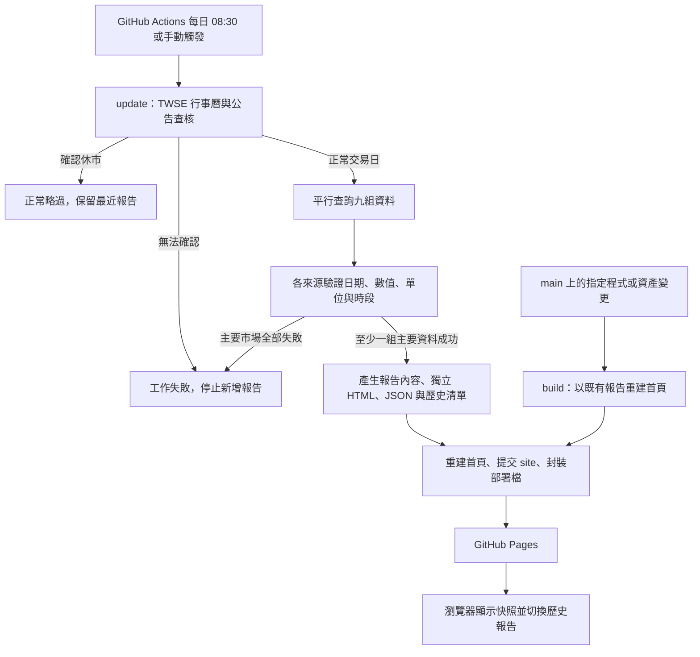

# 架構與資料流程

[回 README](../README.md) · 前一篇：[快速上手](GETTING_STARTED.md) · 下一篇：[資料規格](DATA_GUIDE.md)

## 系統在做什麼？

PMOT 是一個「定時查資料、產生固定報告、發佈靜態網站」的程式。Python 負責查詢、驗證、判讀及產生檔案；瀏覽器的 JavaScript 負責切換歷史報告。使用者開啟網站不會觸發行情查詢。

圖中的「主要市場」是除了 `spot` 現貨比較資料以外的八組資料。部分來源失敗仍可產生 `partial` 報告；成功不代表每項都有數字。

## 模組分工與閱讀順序

| 順序／檔案 | 主要責任 | 閱讀入口 |
| --- | --- | --- |
| 1. `pmot/__main__.py` | 命令入口、交易日門檻、組合各來源、判斷是否發佈、回報 CI 結果 | `main()` → `update()` |
| 2. `pmot/http.py` | HTTPS、逾時與重試、來源紀錄、獨立任務平行執行 | `Fetcher.text()`、`parallel()` |
| 3. `pmot/sources.py` | 來源格式轉換與金融資料驗證 | `trading_day()`，再閱讀各 `parse_*()` |
| 4. `pmot/render.py` | 格式化、固定規則判讀、HTML、檔案與歷史清單 | `render_report()` → `publish()` → `build_index()` |
| 5. `site/assets/app.js` | 歷史選單、網址參數、載入狀態、章節導覽 | `start()` → 內部 `load()` |
| 6. `.github/workflows/` | 檢查、排程、提交與部署 | `ci.yml` 與 `daily-report.yml` |
| 7. `tests/test_market_data.py` | 使用合成資料驗證邊界條件 | 四組測試類別 |

來源模組盡量將「下載」與「解析」分開。例如 `tx()` 準備 URL 並下載，`parse_tx()` 接收 HTML 字串與目前時間後驗證內容。測試就能直接給 HTML 範例，不受真實行情或網路影響。

## build 與 update 的差別

| 指令 | 是否查新行情 | 輸入 | 寫入 |
| --- | --- | --- | --- |
| `python -m pmot build` | 否 | `site/data/reports.json` 第一筆指定的內容片段 | `site/index.html` |
| `python -m pmot update` | 是 | 官方行事曆、公告及各市場來源 | 新報告 HTML、JSON、內容片段、歷史清單及首頁 |

兩個指令都支援 `--site <目錄>`。`build` 需要該目錄已有歷史清單與對應片段；空目錄不能直接 build。`update` 只有通過交易日與資料門檻才會新增檔案。

## 一份報告如何變成網站？

以一個自動產生的報告識別字 `YYYY-MM-DD_HHMMSS` 為例：

| 路徑 | 用途 |
| --- | --- |
| `site/data/YYYY-MM-DD_HHMMSS.json` | 結構化資料、來源查核紀錄與執行時間。 |
| `site/data/YYYY-MM-DD_HHMMSS.html` | 報告內容片段；首頁切換日期時載入。 |
| `site/reports/YYYY-MM-DD_HHMMSS.html` | 可單獨開啟的完整歷史報告，引用共用 CSS／JS。 |
| `site/data/reports.json` | 所有可選報告的清單；正常發佈後按產出時間由新至舊排序。 |
| `site/index.html` | 包含最近報告的完整首頁，即使 JavaScript 無法載入仍能閱讀內容。 |

`build_index()` 直接使用清單的第一筆，並不自己重新排序。新報告發佈時，`publish()` 才負責插入與排序。這個差異也讓維護者能透過清單暫時回復舊報告。

## 哪些檔案應該修改？

- **程式來源**：`pmot`、`site/assets`、工作流程、測試與文件。
- **自動產物**：`site/index.html`、`site/data`、`site/reports`；通常由程式更新，不直接手改行情或判讀文字。
- **需求規格**：根目錄的 `台股開盤前外部市場觀察清單_prompt.md`，及網站上的副本 `site/prompt.md`。Markdown 不會在 GitHub 執行時被當成 AI 指令，實際邏輯仍由程式實作。
- **本機歷史工作檔**：根目錄 `reports`、`evidence`、`tmp` 與一次性建置腳本不屬於正式雲端流程；部分只存在原作者電腦，已被 Git 忽略。clone 後沒有這些檔案是正常的。

## CI/CD 的三個分支

1. **PR**：`ci.yml` 跑測試與既有首頁重建，不部署正式網站。
2. **main 上符合 paths 的 push**：測試後執行 `build`，以既有內容重建並部署。僅修改 README／docs 不會觸發每日部署流程。
3. **schedule／workflow_dispatch**：測試後執行 `update`；正常略過時 `changed=false`，不提交、不封裝、不部署。

每日流程的 `build` job 具有 `contents: write`，用來保存新報告；`deploy` job 具有 `pages: write` 與 `id-token: write`，用來發佈網站。兩個 job 以 `changed` 輸出銜接。自動提交帶 `[skip ci]`，避免自己的提交再引發不必要的 push 工作流程。

## 目前的系統邊界

來源成功與失敗各自保留；交易日無法確認時整次停止。檔案發佈目前依序寫入，尚非整批原子操作，寫入中斷仍須人工檢查；不要把來源錯誤的保護邏輯延伸理解成所有檔案故障都能自動恢復。詳見[維運手冊](OPERATIONS.md)與[發展路線](ROADMAP.md)。
