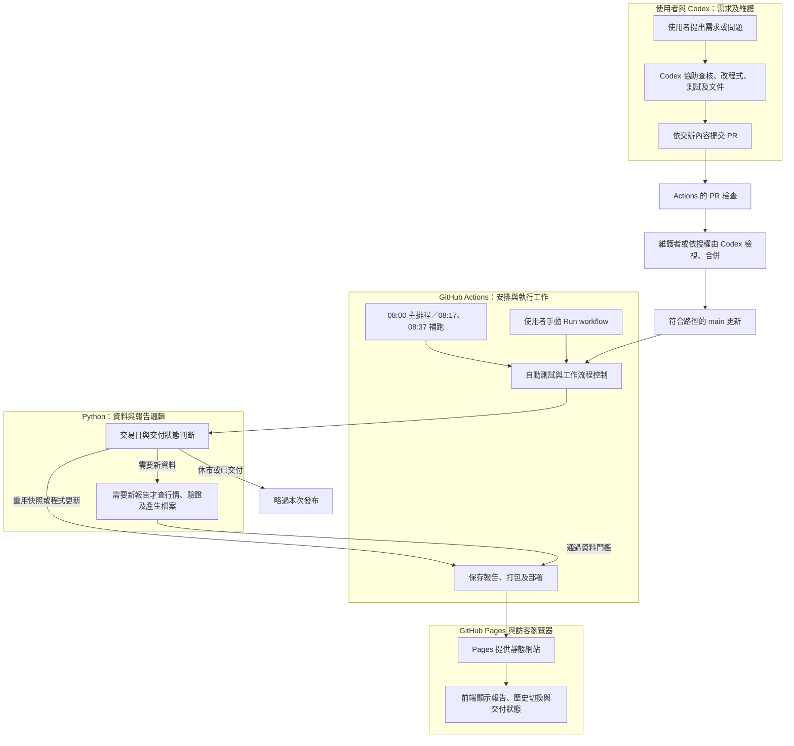
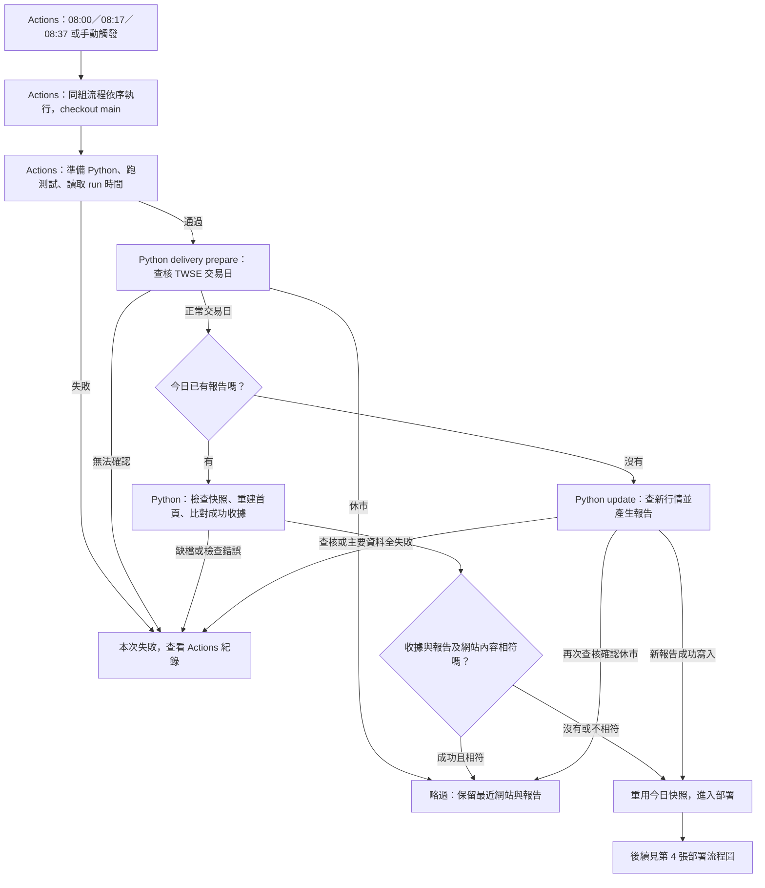
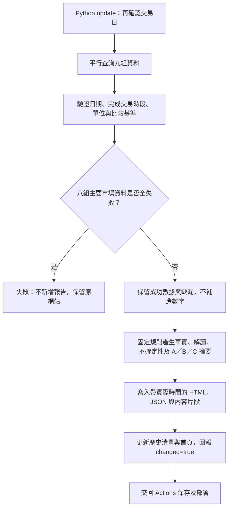
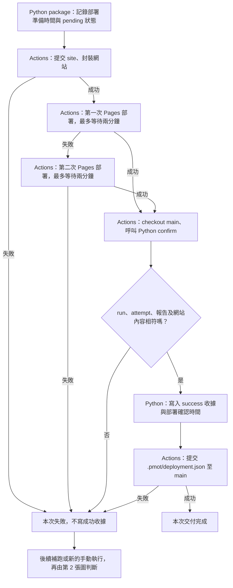
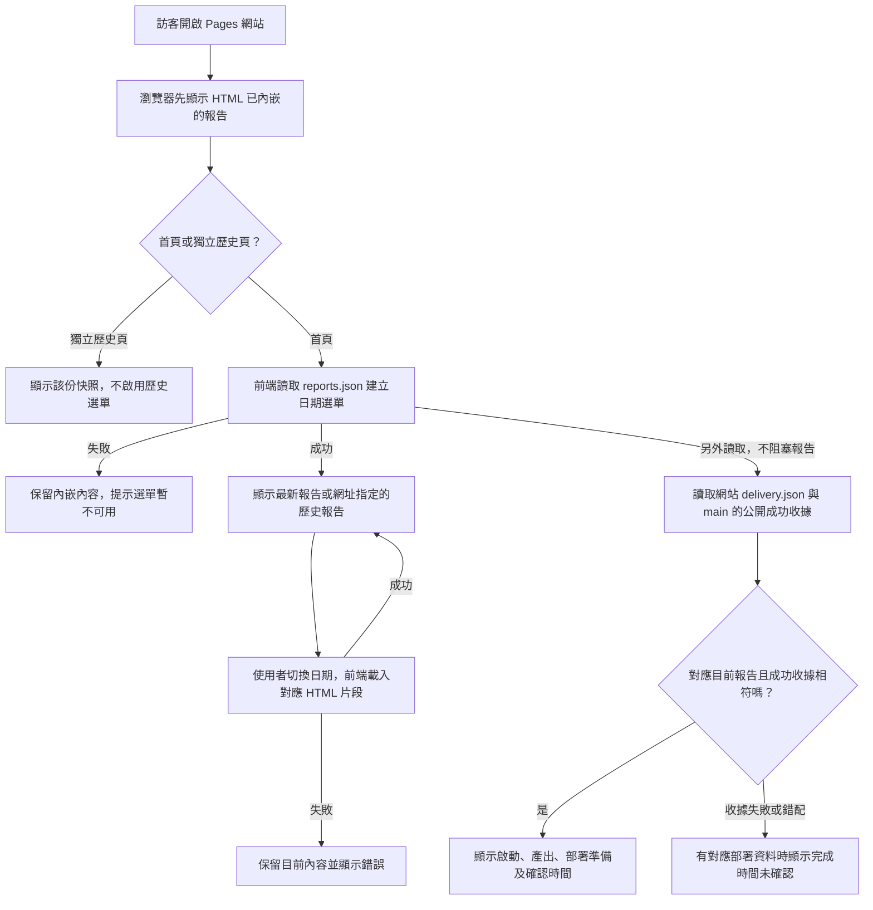
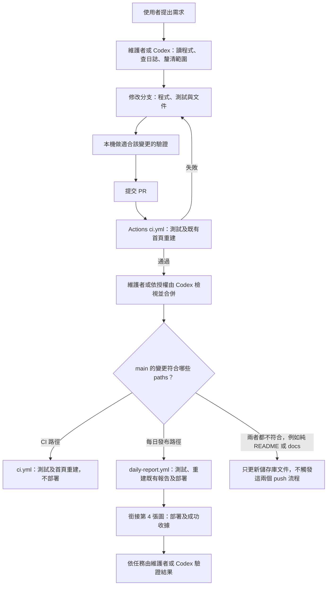

# PMOT 自動化流程圖與分工

[回 README](../README.md) · [新手快速上手](GETTING_STARTED.md) · [程式架構](ARCHITECTURE.md) · [部署與時間紀錄](DELIVERY.md)

PMOT 每天由 GitHub Actions 啟動，呼叫 Python 查資料、產生報告並部署到 GitHub Pages。訪客開網站時，前端只讀已產生的檔案。Codex（這個對話中的 AI 助手）依使用者交辦協助開發與查核；每日流程沒有呼叫 Codex 或其他 AI 模型。

第一次閱讀建議先看第 1、2 張圖，再依問題看後面的細節。圖中方框表示步驟，菱形表示條件，箭頭上的文字表示走哪個分支；「略過」是正常結束，「失敗」需要查看紀錄。

| 新手會遇到的詞 | 在 PMOT 的意思 |
| --- | --- |
| workflow／run | 一套自動工作流程／這套流程的一次執行紀錄 |
| job／step | 一次執行內的工作單位／工作內的步驟；`build` 與 `deploy` 是 job 名稱 |
| 快照 | 某次實際查詢後保存的固定報告；重試部署不更改其中行情 |
| 成功收據 | Pages 回報成功後保存的 JSON 紀錄，表示哪份內容在哪次執行被確認交付 |
| 雜湊（hash） | 從檔案內容計算的指紋，用來比對內容是否改變 |
| artifact | Actions 打包或保留的檔案，例如網站部署套件與時間紀錄 |

## 1. 全貌：誰負責哪一段？

Python 不是另一台常駐伺服器，而是在 Actions 的執行機上被呼叫的程式。Codex 不會因為每天 08:00 到了就自動進入對話，也沒有持續在背景監控網站。

| 角色 | 實際負責 | 執行時機 |
| --- | --- | --- |
| GitHub Actions | 定時或手動觸發、準備 Python、跑測試、串接步驟、提交檔案、部署與重試、保存紀錄 | workflow 被觸發時 |
| Python | 交易日查核、是否新建報告、行情下載與驗證、固定規則判讀、HTML／JSON、雜湊及收據 | Actions 或使用者在本機下指令時 |
| GitHub Pages | 提供已部署的 HTML、CSS、JavaScript 與 JSON | 網站被存取時 |
| 網站前端 | 歷史選單、章節導覽、分享網址、列印、實際時間及收據狀態 | 訪客開啟網站、操作頁面時 |
| 使用者／維護者 | 決定需求、處理需人工確認的公告或資料問題、檢視變更、手動補跑 | 有需求或異常時 |
| Codex（我） | 依交辦讀程式與日誌、分析、改程式、補測試與文件，授權範圍內協助 PR、合併及部署驗證 | 在對話中收到任務時 |

GitHub 顯示的 `github-actions[bot]` 提交，是 workflow 保存報告或收據，並非 Codex 每天操作 GitHub。

## 2. 每日與手動流程：要產報告、重試，還是略過？

以下適用 schedule 與手動 `workflow_dispatch`。時間一律以 Asia/Taipei 為準，每天含週末都可能喚醒；交易日由 Python 查核。

08:17、08:37 是備援機會，不是固定再抓兩次行情。同一天的報告即使部分資料未確認，只要已成功交付且內容相符，補跑仍會略過。它不會自動把缺值補齊；要重新查行情，須由維護者明確處理。

例如：假設 08:02 已產報告但部署失敗，08:17 補跑會重用 08:02 的快照；若 08:17 部署成功並寫入收據，08:37 就略過。這是流程示例，不是實際執行時間紀錄。

## 3. Python 如何查資料與產生報告？

「六項市場章節」對應九組查詢：美股三大指數各一組、TSM、SOX、TX、前日台股現貨、10 年期美債殖利率、DXY。現貨 `spot` 只供期現比較，其餘八組是主要資料；不能只憑現貨成功就產出市場報告。

下載器對單次來源請求最多嘗試兩次；TSM 另有備援來源。來源通過解析驗證不等於已全面交叉查證，缺漏會列出，報告成功也不保證行情方向。判讀來自程式規則，沒有每日 AI 生成步驟。各金融口徑見[資料規格](DATA_GUIDE.md)。

## 4. 部署、重試與成功收據如何銜接？

只產生報告、只完成打包，都不能視為部署成功。打包時的 `site/data/delivery.json` 保持 `pending`；成功後另寫 `.pmot/deployment.json`，不能把尚未發生的完成時間預填進網站。

如果 Pages 已成功但收據提交失敗，下次可能再部署一次，這比誤判已完成安全。若資料保存／封裝失敗，流程不會直接跳去部署。檔案寫入中斷並非所有情況都能自動恢復，仍可能需要人工檢查。

自動提交帶 `[skip ci]`，且使用 workflow 的 GitHub token，避免自己的報告提交造成循環。`build` job 與 `deploy` job 都有保存各自產物所需的 `contents: write`；Pages 發布另需 `pages: write` 與 `id-token: write`。

## 5. 訪客開網站後，前端會自動做什麼？

前端也會自動標示今日／歷史、更新章節導覽及分享網址，使用者可列印或另存 PDF。較早但較慢的切換請求不會蓋過最新選擇；未對應目前所選報告的部署資訊會隱藏。

前端請求的是已產生的報告與部署紀錄，不是即時行情；開頁面或重新整理不會叫 Python 重新抓資料。公開收據連線失敗時，報告仍可閱讀。收據表示 Pages action 成功後已確認，不是所有地區 CDN 的獨立可用性保證。

## 6. 改程式時，Codex、CI 與部署如何分工？

一個 push 可以同時符合兩個 workflow；例如修改 `pmot/**`，會同時跑 CI 與每日發布流程。合併純文件 PR 前仍會跑 PR CI；合併後，純 README／docs 變更不觸發正式網站部署。

| 入口 | 實際觸發範圍 | 是否查新行情 |
| --- | --- | --- |
| `ci.yml` 的 PR | PR 活動（目前未限制檔案路徑） | 否，只用合成測試及既有報告 |
| `ci.yml` 的 main push | `pmot/**`、`tests/**`、`.github/workflows/ci.yml` | 否 |
| `daily-report.yml` 的 main push | `pmot/**`、`site/assets/**`、`site/prompt.md`、`site/data/reports.json`、`tests/**`、每日 workflow 本身 | 否，只重建及部署既有內容 |
| 每日三個時槽／手動 Run workflow | 進入交易日與交付狀態判斷 | 今日沒有報告時才查 |
| 本機 `python -m pmot build` | 使用者明確下指令 | 否，只重建首頁；不提交或部署 |
| 本機 `python -m pmot update` | 使用者明確下指令 | 是；仍查交易日，但不經 delivery 防重複，也不提交或部署 |

正式更新不依賴本機電腦持續開機。舊 Codex 本機每日排程已移除；沒有另外一個每日 AI 報告任務。Codex 不會自動檢查每次 PR、合併 PR 或追蹤未來交易日，這些協助須有交辦任務與授權。

## 發生問題時，先看哪裡？

| 現象 | 先確認 | 負責的位置 |
| --- | --- | --- |
| 08:00 到了卻沒有執行紀錄 | 是否尚未觸發、工作流程是否啟用；補跑也可能延遲 | GitHub Actions 排程 |
| run 失敗，沒有新報告 | 測試、官方交易日或主要資料查詢錯誤 | Actions 日誌與 Python |
| 有今日報告但網站沒更新 | package、Pages action、成功收據是否完成 | Actions 與 `delivery.py` |
| run 成功但 deploy 顯示 skipped | 決策是否為休市或當日已成功交付 | Actions Summary 的 decision／reason |
| 網站顯示舊日期 | 正常休市保留舊報告，或當日交付尚未成功 | 報告日期、Actions、收據 |
| 網站顯示部署時間未確認 | 公開收據讀取失敗、快取尚未更新或 run／內容不相符 | 前端及成功收據 |

GitHub 排程不保證準時，三個時槽仍可能共同延遲。交易日公告檢查與來源新鮮度有既有限制；完整時間欄位與恢復方式見[每日交付機制](DELIVERY.md)、[維運手冊](OPERATIONS.md)及[路線圖](ROADMAP.md)。

## 從圖找到程式

| 流程 | 主要檔案 |
| --- | --- |
| 每日觸發、步驟條件、部署重試、提交 | [daily-report.yml](../.github/workflows/daily-report.yml) |
| PR／main 程式檢查 | [ci.yml](../.github/workflows/ci.yml) |
| 交付決策、內容雜湊、pending 與 success 收據 | [delivery.py](../pmot/delivery.py) |
| 行情工作與 CLI | [__main__.py](../pmot/__main__.py) |
| 下載重試、平行查詢、來源口徑驗證 | [http.py](../pmot/http.py)、[sources.py](../pmot/sources.py) |
| 固定規則判讀、HTML、清單與首頁 | [render.py](../pmot/render.py) |
| 網站互動與交付狀態 | [app.js](../site/assets/app.js) |
| 資料邊界及失敗恢復測試 | [test_market_data.py](../tests/test_market_data.py)、[test_delivery.py](../tests/test_delivery.py) |

本文件描述目前程式實作；修改 workflow、交付邏輯或前端時，應同步核對對應流程圖，避免新手讀到舊流程。
