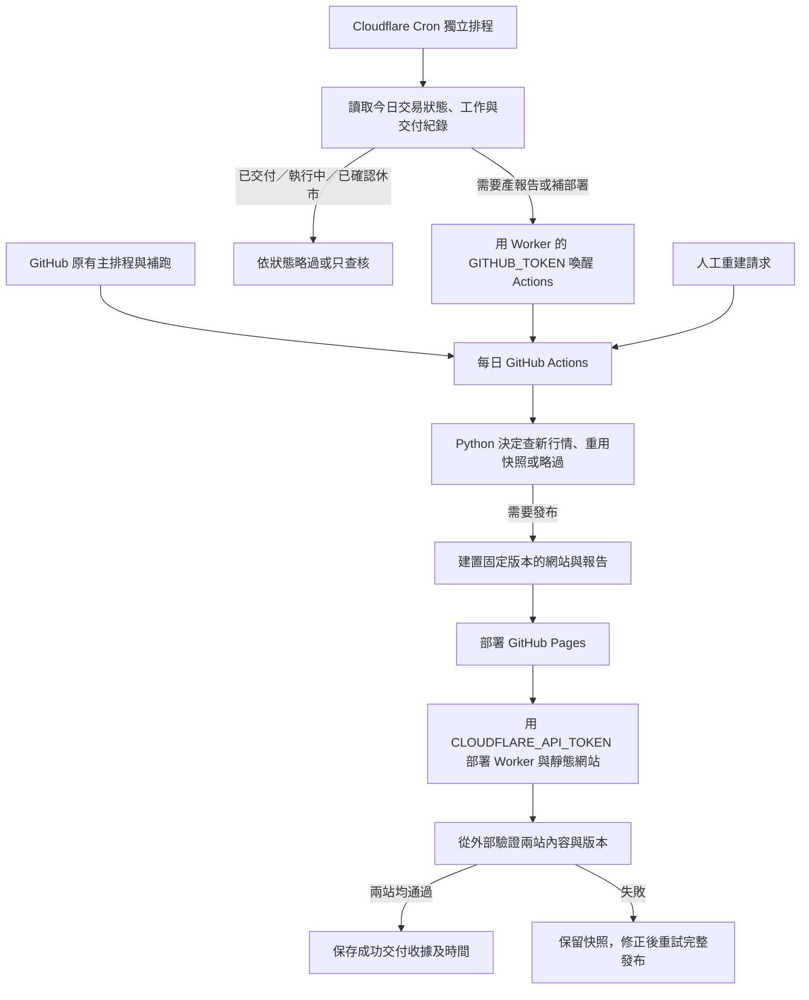

# PMOT 部署到 Cloudflare：新手逐步操作與維護指南

整理日期：2026-11-25。依本次設定對話、Cloudflare 新版 Policies 畫面及目前專案程式整理。

[回專案首頁](../README.md) · [獨立觸發設定](CLOUDFLARE_SETUP.md) · [最新報告與雙站發布](LATEST_SITE.md) · [交付機制](DELIVERY.md)

> 本文件記錄設定方法與操作過程。側對話整理時只確認到 Token 摘要；主對話後續已確認 GitHub Secret、完成測試與雙站部署。實際時間、執行紀錄與驗收限制請見 [2026-11-25 上線驗收](audits/2026-11-25-cloudflare-site.md)，不要只以設定步驟判定部署成功。

## 1. 先理解各元件的分工

PMOT 使用同一份報告快照發布到 Cloudflare Worker 網站及 GitHub Pages。Cloudflare 另負責獨立排程喚醒；行情查詢、交易日確認、報告建置與發布工作仍由 GitHub Actions 執行。



| 元件／人員 | 負責事項 | 不應誤認的事情 |
| --- | --- | --- |
| Cloudflare Worker | Cron 喚醒、交付查核、提供靜態網站 | 喚醒受理不等於報告已部署 |
| GitHub Actions | 執行測試、Python、雙站部署及公開驗證 | 排程時間不等於完成時間 |
| Python | 官方交易日確認、行情驗證、HTML／JSON、交付判斷 | 休市不能把舊行情改標成今日 |
| 網站前端 | 載入最新報告、保留歷史選擇、定期檢查清單 | 前端輪詢不會重新查行情 |
| 維護者 | 管理帳號與金鑰、檢查失敗、確認交付證據 | 不需要每天開著本機電腦 |
| Codex／協作者 | 依任務修改程式、測試、整理文件、協助查核 | 對話助手不是每日常駐排程器；金鑰由持有人直接輸入服務 |

## 2. 認識三組金鑰與一個帳號識別碼

| 名稱 | 存放位置 | 用途 |
| --- | --- | --- |
| `CLOUDFLARE_API_TOKEN` | GitHub → Repository secret | Actions 部署 Cloudflare Worker 與靜態資產 |
| `CLOUDFLARE_ACCOUNT_ID` | GitHub → Repository variable | 指定部署的 Cloudflare 帳號；不是 Zone ID |
| `GITHUB_TOKEN` | Cloudflare Worker → Secret | Worker 呼叫 GitHub API、讀取紀錄與喚醒流程 |
| `CHECK_TOKEN` | Cloudflare Worker → Secret | 保護人工交付查核入口 `/check` |

Cloudflare Worker 中的 `GITHUB_TOKEN` 是另外設定的專用 GitHub token，不是 GitHub Actions 自動提供的 `github.token`。新增 Cloudflare 部署金鑰時，不必重設既有 Worker 的兩個 Secrets。

本專案 Account ID：`dcdc6dd83b0f815de3d5ef4dd7657422`。這是識別碼，不是 Token 值。

## 3. Step 1：登入與核對帳號

如果只是讓 GitHub 每日部署，可直接進入下一節建立 API Token；本機 OAuth 登入不能取代 CI 使用的 API Token。

需要本機維護時，在 PowerShell 執行：

```powershell
Set-Location D:\Downloads\PMOT\cloudflare
npm ci
npx wrangler login
npm run whoami
```

確認帳號包含上述 Account ID。本次曾遇到 `Could not reach the Cloudflare auth server`，後來重新執行登入並用 `whoami` 確認成功。遇到同類錯誤，先核對網路與登入結果；不要僅以瀏覽器授權頁已開啟判定成功，也不要關閉 TLS 驗證。

## 4. Step 2：建立 Cloudflare 部署 Token（新版 Policies 介面）

1. 開啟 [Cloudflare 個人 API Tokens](https://dash.cloudflare.com/profile/api-tokens)，登入正確帳號。
2. 選 **Create Token**；可選 **Edit Cloudflare Workers** 範本，或使用自訂 Token。
3. **Token name** 填入 `PMOT GitHub Deploy`。
4. 找到 **Policies** 區塊。若已有 **Account policy**，按該卡片右側的鉛筆；若沒有，從 **Add new policy** 新增 Account policy。
5. 在 **Edit Account policy** 最上方保留 **Include**。點右側 **All accounts**，改選 PMOT 所在帳號。本次顯示為 `Cjw.9223233@gmail.com's Account`；請同時核對 Account ID。
6. 若無法選其他帳號，可先按帳號欄位的 **×** 清除原選項，再選指定帳號。

舊指南所寫的 **Account Resources → Include → Specific account**，在本次新版畫面已改由 **Account policy** 內的資源規則設定；不必再尋找舊欄位名稱。

### 清除多餘權限，再加入兩項需要的權限

1. 先清空 **Search for permission groups...** 搜尋框。
2. 展開右側 **Bulk Select**。
3. 選最下方紅字 **Clear all permissions**。這會連已勾選的必要權限一起清除，後面要重選。
4. 搜尋 `Workers Scripts`，在名稱完整為 **Workers Scripts** 的那一列勾 **Edit**。不要誤選另一列名稱只有 **Workers** 的權限。
5. 搜尋 `Account Settings`，勾 **Read**。
6. 清空搜尋框，檢查是否有其他誤勾的權限。
7. 若有不需要的 **Zone policy** 或 **User policy**，按各卡片右側紅色垃圾桶，移除整張政策。Account policy 內的 Clear all 不代表其他政策也清除了。

**搜尋只會篩選畫面，不會清除被隱藏的勾選。** Bulk Select 的另兩項 **Add all Read & Write permissions**、**Add all Read-only permissions** 都是增加權限，不能用來取消勾選。

### 檢查 Token Summary

1. Client IP address filtering 不填 IP 限制，避免動態 GitHub runner IP 被擋。
2. Token expiration 依維護安排設定並記錄。本次摘要為 **No expiration**；若設定到期日，要在到期前更換 GitHub Secret。
3. 按 **Continue to summary**。
4. 確認名稱為 `PMOT GitHub Deploy`，Permission policies 只有指定帳號及以下兩項：

   ```text
   Workers Scripts: Edit
   Account Settings: Read
   ```

5. 本次摘要中的 **Entire [帳號名稱] account** 表示涵蓋該指定帳號內的資源，不是所有 Cloudflare 帳號，也不是僅限單一 PMOT Worker。
6. 確認後按 **Create Token**，複製產生的 Token 值。Token secret 只顯示一次；不要複製整段測試指令，也不要將金鑰貼入聊天、原始碼或截圖。

以上是本專案目前採用的權限配置；未來若增加自有網域、KV、R2 或其他服務，應依實際 API 需求重新評估，不要直接授予所有寫入權限。

## 5. Step 3：把 Token 存入 GitHub

1. 開啟 [PMOT Actions secrets 設定頁](https://github.com/cjw9223233/PMOT/settings/secrets/actions)。手動路徑是專案 **Settings → Secrets and variables → Actions**。
2. 選 **Secrets** 分頁，在 Repository secrets 區按 **New repository secret**。
3. **Name** 填 `CLOUDFLARE_API_TOKEN`。
4. **Secret** 貼入剛建立的 Cloudflare Token 值。
5. 按 **Add secret**。若同名 Secret 已存在，編輯並更新原項目。
6. 確認列表出現該名稱；儲存後看不到原值是正常的，不必為了確認而公開金鑰。
7. 切到 **Variables** 分頁，確認 Repository variable `CLOUDFLARE_ACCOUNT_ID` 為 `dcdc6dd83b0f815de3d5ef4dd7657422`。目前 workflow 讀取 `vars.CLOUDFLARE_ACCOUNT_ID`，因此本專案應放在 Variables；僅新增同名 Secret 不會滿足這個設定。

完成這一步僅代表憑證已存好，尚不能宣稱網站部署成功。

## 6. Step 4：測試與第一次人工發布

本機先檢查 Worker（不會正式部署）：

```powershell
Set-Location D:\Downloads\PMOT\cloudflare
npm ci
npm test
npm run dry-run
```

專案的 `Validate source changes` CI 另執行 Python 測試、既有報告重建、Worker 測試及打包檢查。測試通過只證明程式檢查通過，不能代替真實 Token 與線上發布驗證。

正式發布前，確認目標程式已合併到 `main`，且 GitHub Secret／Variable 均存在。

1. 開啟 [PMOT Actions](https://github.com/cjw9223233/PMOT/actions)。
2. 選 **Deploy independent Cloudflare trigger**，按 **Run workflow**，使用 `main`。
3. 此流程會送出 `daily-report.yml` 的 `rebuild_only=true` 請求；它本身成功只表示請求成功。
4. 繼續追蹤新建立的 **Daily market report and GitHub Pages**。人工重建使用既有報告，不查詢新行情。
5. 確認 GitHub Pages 部署、Cloudflare 部署、兩站公開驗證與成功收據步驟全部通過。
6. 若失敗，先閱讀失敗步驟，不要重複連按 Run workflow。

本機 `npm run deploy` 會直接部署 Worker，適合必要的除錯；它不會完整執行兩站公開驗證及交付收據流程，日常發布請走上述 Actions。

## 7. Step 5：驗收網站、排程及交付

| 驗收項目 | 操作與通過條件 |
| --- | --- |
| Cloudflare 網站 | 開啟 [Worker 首頁](https://pmot-independent-trigger.cjw-9223233.workers.dev/)，報告可讀 |
| GitHub Pages | 開啟 [Pages 首頁](https://cjw9223233.github.io/PMOT/)，確認同版報告 |
| 最新日期 | 無 `?report=` 的首頁載入最新已存在報告，日期與內文一致 |
| 歷史選擇 | 選歷史報告後保持原選擇；按「回到最新」才切回最新模式 |
| 健康端點 | `/health` 可回應；它只證明端點存活，不代表已交付 |
| 查核保護 | `/check` 仍須 CHECK_TOKEN；查核方法見原設定指南 |
| 真實獨立喚醒 | Cloudflare Cron 日誌對應到 GitHub run，標示 `trigger_source=cloudflare` |
| 休市略過 | 有今日官方查核為 closed 的證據，且沒有今日新報告；不是只看週末 |
| 09:00 前完成 | 讀取當日首次成功交付證據，確認兩站已公開驗證；不使用排程或建置開始時間代替 |

目前本機設定檔的時槽如下；未來調整時先查程式，不要只依文件操作：

| 平台 | Asia/Taipei 時間 | 設定來源 |
| --- | --- | --- |
| Cloudflare 觸發／補跑 | 08:00、08:10、08:30 | `cloudflare/wrangler.jsonc`，Cron 為 UTC `0,10,30,45,55 0 * * *` |
| Cloudflare 只查核 | 08:45、08:55 | 同上，由 Worker 判斷各時槽行為 |
| GitHub 原排程 | 08:00、08:17、08:37 | `.github/workflows/daily-report.yml`，明定 `timezone: Asia/Taipei` |

保留兩套排程是為增加喚醒機會，不是保證在 09:00 前完成。補跑依今日快照、執行狀態與收據決定是否需要工作。08:45／08:55 異常目前記錄於 Cloudflare 日誌／失敗事件，不代表自動寄信或傳送聊天通知。

## 8. 常見問題與後續維護

| 現象 | 檢查與處理 |
| --- | --- |
| 找不到 Account Resources | 使用新版 Account policy 的鉛筆，編輯 Include 及指定帳號 |
| 搜尋後只剩兩列，看似沒有其他權限 | 搜尋不會取消其他勾選；清空搜尋後 Clear all，再重選必要項目 |
| 選單有 Add all… | 那是增加權限；清除應選紅色 Clear all permissions |
| Missing CLOUDFLARE_API_TOKEN | 檢查 GitHub Repository secret 名稱及所在儲存庫 |
| Missing CLOUDFLARE_ACCOUNT_ID | 檢查 Repository variable，而不是只有同名 Secret |
| Cloudflare 401／403 | 檢查 Token 有效性、權限與指定帳號；不要直接增加所有權限 |
| wrapper 工作成功但網站沒更新 | 追蹤它另行送出的 Daily 工作，確認實際部署與公開驗證結果 |
| 只有一站成功 | 視為尚未完成交付；修正後重試完整發布，重用既有快照 |
| 休市首頁不是今天 | 正常保留最近報告的真實日期；核對今日交易日紀錄是否明確 closed |
| Token 遺失、到期或撤銷 | 建立同帳號同權限的新 Token，更新 GitHub Secret，再驗證發布 |
| Token 意外公開 | 撤銷受影響的 Token、建立替代值並更新對應 Secret；不將舊值寫入問題單 |

交接時至少留下：變更日期、commit／PR、Actions run URL、兩站公開驗證結果、首次交付時間與時區、排程查核結果、未完成項目及 Token 到期日（不記 Token 值）。較晚的程式改版發布，不應被誤判為當日首次報告逾時。

## 9. 本次對話的設定過程整理

1. 本機 OAuth 曾因無法連線到 Cloudflare auth server 失敗；後續使用者重新登入，`whoami` 顯示成功。
2. 獨立觸發使用的 Worker `GITHUB_TOKEN` 曾由使用者透過 Wrangler Secret 提示直接上傳；它與本次新增的部署 Token 用途不同。
3. 為讓 GitHub Actions 每日發布 Cloudflare 網站，新增 `CLOUDFLARE_API_TOKEN` 設定需求。
4. 初始指引沿用舊版 Account Resources 欄位，使用者提供新版 Policies 畫面後，改以 Account policy 的鉛筆設定帳號範圍。
5. 畫面曾有大量既存權限；搜尋不會取消它們，最後確認使用 Bulk Select → Clear all permissions 清除。
6. 重新加入 Workers Scripts Edit、Account Settings Read，移除額外 Zone／User policy。
7. 使用者提供 Token Summary：名稱、單一帳號及兩項權限均符合本次配置，後續步驟為 Create Token，再儲存 GitHub Repository secret。
8. 側對話整理時尚未包含後續部署；主對話之後已確認 GitHub Secret 名稱與 Account ID，77 項測試通過，雙站於 2026-11-25 09:48:30 完成改版發布，重跑正確略過。今日原報告 08:01:09 的首次交付與本次改版時間分開記錄，詳見[上線驗收](audits/2026-11-25-cloudflare-site.md)。未讀取或公開 Token 值。

## 10. 維護時要閱讀的程式與官方文件

- [Worker 設定](../cloudflare/wrangler.jsonc)：名稱、資產目錄、Cron、非機密變數。
- [Worker 主程式](../cloudflare/src/worker.mjs)：路由、喚醒與交付查核。
- [每日工作流程](../.github/workflows/daily-report.yml)：主排程、補跑、部署重試與收據。
- [人工發布入口](../.github/workflows/cloudflare-worker.yml)：送出重建請求。
- [CI 檢查](../.github/workflows/ci.yml)：程式驗證，不負責部署。
- [公開網站驗證](../cloudflare/scripts/verify-sites.mjs)：核對兩站與固定快照。
- [Cloudflare 建立 API Token](https://developers.cloudflare.com/fundamentals/api/get-started/create-token/)：新版政策、範圍與 Token 管理。
- [Cloudflare GitHub Actions 部署](https://developers.cloudflare.com/workers/ci-cd/external-cicd/github-actions/)：CI 使用 API Token 與 Account ID；本機 OAuth 與 CI 憑證的差別。
- [GitHub Actions Secrets](https://docs.github.com/en/actions/how-tos/write-workflows/choose-what-workflows-do/use-secrets)：Repository secret 操作。

介面可能持續改版；若標籤不同，先確認政策類型、帳號範圍及權限摘要，再參照官方文件，不要盲目套用舊截圖。
