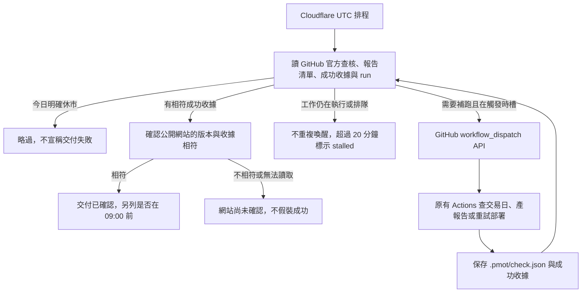

# Cloudflare 免費獨立觸發：新手設定與驗收

[回 README](../README.md) · [自動化流程](AUTOMATION.md) · [GitHub 交付機制](DELIVERY.md)

Cloudflare Worker 負責喚醒及查核，行情、交易日判斷、HTML 與 Pages 部署仍由 GitHub Actions／Python 執行。GitHub 原有 08:00、08:17、08:37 備援全部保留；沒有遷移網站、啟用付費方案或常駐本機程式。**檔案合併不等於 Worker 已上線**，須完成登入、設定 Secret、部署及下列驗收。

原專案已於 2026-11-20 完成部署與 Cron 啟用，實測與待驗收項目見[上線紀錄](audits/2026-11-20-cloudflare-activation.md)。以下步驟供重建、更新或其他帳號使用；不必重設已存在的金鑰。

## 1. 先看流程



Worker 不自行用星期幾推論台股休市。Actions 的 `prepare` 成功查核後保存 `market_state=open/closed`；無法確認則保存 `unknown` 並使原工作失敗。程式更新的 push 不查交易日，也不會蓋掉已有查核紀錄。

## 2. 需要的帳號與工具

- GitHub：能管理 `cjw9223233/PMOT` 的帳號。
- Cloudflare：使用 Workers Free 即可，無須自有網域。
- 本機：Git、Node.js 22 以上、npm。原 Python 測試仍依專案快速上手設定。

在 PowerShell 進入專案：

```powershell
Set-Location D:\Downloads\PMOT\cloudflare
npm ci
npm test
npm run dry-run
```

`npm test` 使用合成回應，不連真實 GitHub、不部署。`dry-run` 由官方 Wrangler 檢查並打包 Worker，不會建立雲端服務。若 npm 出現憑證錯誤，先修復本機信任憑證或使用乾淨環境／CI；不要關閉 TLS 驗證。

## 3. 建立專用 GitHub 金鑰

GitHub → Settings → Developer settings → Personal access tokens → Fine-grained tokens → Generate new token。

| 設定 | 值 |
| --- | --- |
| Resource owner | `cjw9223233` |
| Repository access | Only select repositories → `PMOT` |
| Repository permissions | **Actions: Read and write**、**Contents: Read-only**（另有自動必要的 Metadata read） |
| Expiration | 自行選擇到期日並記錄更新提醒 |

Actions write 用於喚醒及讀 run；Contents read 用於讀取查核紀錄、清單與收據。Worker 不需要 Contents write、Pages write 或 Cloudflare 管理金鑰。此權限仍可操作 PMOT 的 Actions，應視同密碼保管。

不要使用本機 `gh` 的廣泛 OAuth token，也不要把金鑰貼進聊天、README、`wrangler.jsonc` 或 git。下面的互動提示會讓你直接輸入 Secret。

## 4. 本機 OAuth 失敗時：改由 GitHub Actions 部署（建議替代路徑）

若瀏覽器出現 `Could not reach .../oauth2/token`，本機 Node 可能無法完成 HTTPS 憑證／代理連線。API Token 可以避開 OAuth，但如果同一台電腦連 Cloudflare API 也失敗，僅改 token 並不能解決網路問題。此時直接讓 GitHub runner 部署，不必反覆在本機登入，也不要關閉 TLS 驗證。

1. 用瀏覽器登入 Cloudflare Dashboard，進入帳號 API Tokens（或 My Profile → API Tokens），使用 **Edit Cloudflare Workers** 範本，僅選本次使用的 account；保留範本部署 Workers／Cron 所需權限。建立的是 Cloudflare 部署 token，與前一節 GitHub token 不同。
2. 從帳號頁面取得 **Account ID**，不要填 Zone ID。首次使用時，先在 Workers & Pages 開通免費 Workers 並確認 workers.dev 子網域已設定；不要選擇升級付費。
3. GitHub 儲存庫 → Settings → Secrets and variables → Actions，新增下表。金鑰直接填入 GitHub 表單，不貼聊天、不存進程式。

| 類型 | 名稱 | 填什麼 |
| --- | --- | --- |
| Repository secret | `CLOUDFLARE_API_TOKEN` | Cloudflare 的 Workers 部署 token |
| Repository secret | `PMOT_DISPATCH_TOKEN` | 第 3 節限定 PMOT 的 GitHub fine-grained token |
| Repository secret | `PMOT_CHECK_TOKEN` | 自選長且隨機的查核密碼 |
| Repository variable | `CLOUDFLARE_ACCOUNT_ID` | Cloudflare Account ID（非密碼） |

4. 在 Actions 選 **Deploy independent Cloudflare trigger** → Run workflow → main。
5. 流程先測試與 dry-run，再部署程式與排程、透過標準輸入設定 Worker 的 `GITHUB_TOKEN`／`CHECK_TOKEN`，並僅列出 Secret 名稱。所有值由 GitHub Secrets 遮罩保管，不會寫金鑰檔。
6. 部署步驟會顯示 workers.dev 網址。完成後照第 6、7 節查核。新建 Worker 與 Secret 設定之間可能短暫尚未具備憑證，不能在整個流程成功之前視為完成；若設定 Secret 失敗，修正後重跑同一 workflow。

需要 CLI 時，也可在本機使用 `gh secret set CLOUDFLARE_API_TOKEN`、`gh secret set PMOT_DISPATCH_TOKEN`、`gh secret set PMOT_CHECK_TOKEN` 的互動提示直接輸入；Account ID 用 `gh variable set CLOUDFLARE_ACCOUNT_ID` 設定。不要把值放進含明碼的命令列、版本庫或聊天。

這個 workflow **只接受人工觸發**，不會因 PR 或每次 main 更新自動修改 Cloudflare。日後修改 Worker，合併後再人工執行一次。若 GitHub runner 也無法連線，保留錯誤紀錄，不聲稱已部署；原報告排程仍照常保留。

## 5. 本機網路正常時：登入並設定 Secret（替代方式）

```powershell
# 此步會開啟 Cloudflare 瀏覽器授權；確認選擇你自己的 Free 帳號。
npx wrangler login
npm run whoami

# 若 Worker 尚不存在，依提示同意建立 pmot-independent-trigger。
npx wrangler secret put GITHUB_TOKEN
npx wrangler secret put CHECK_TOKEN
```

- `GITHUB_TOKEN`：上一步新建的 GitHub fine-grained token。
- `CHECK_TOKEN`：另選一個長且隨機的密碼，只用於保護 `/check` 唯讀查核；不要與 GitHub token 相同。

只有 Secret 值需要保密；Worker 程式、帳號名稱及排程可公開。若帳號有多個 Cloudflare account，先核對 `whoami`，必要時於本機環境設定正確的 `CLOUDFLARE_ACCOUNT_ID`。不要隨意啟用付費 Workers。

## 5A. 本機部署與共用排程說明

先確認 GitHub main 已有本次 `workflow_dispatch` inputs 及 checkpoint 步驟，再執行：

```powershell
npm run deploy
```

部署完成會顯示 `https://pmot-independent-trigger.<你的子網域>.workers.dev`。原 PMOT 網站網址保持不變。

| 台北時間 | UTC | 行為 |
| --- | --- | --- |
| 08:00 | 00:00 | 查狀態，需要時喚醒 Actions |
| 08:10 | 00:10 | 條件補跑，已有收據或執行中就不排隊 |
| 08:30 | 00:30 | 條件補跑 |
| 08:45 | 00:45 | 只查核；尚未確認時記錄 `alert=true` |
| 08:55 | 00:55 | 只查核；尚未確認或逾時，讓 Cron invocation 失敗供看板辨識 |

設定集中於 [wrangler.jsonc](../cloudflare/wrangler.jsonc)，一條 cron 表達式包含五個分鐘值。Cloudflare Cron 使用 UTC；新建或修改可能需要最多約 15 分鐘傳播，不能剛部署就宣稱排程已驗收。所有時槽都可在休市日喚醒，由原 Python 官方查核決定略過。

Worker 若收到超過 15 分鐘的舊時槽或已跨台北日期，不會再用該時槽觸發。若看到執行中工作超過 20 分鐘，標示 `stalled` 而不持續堆積請求。GET 暫時失敗最多再試一次；POST 結果不明不立即重送，交由下一時槽讀 run 再判斷。兩個平台同時喚醒仍可能產生額外 run，GitHub 原有 concurrency 與快照／收據比對負責避免重複產報告。

## 6. 人工唯讀查核

`GET /health` 只證明 HTTP 程式可回應，不表示 Secret 正確、排程已生效或報告已交付。真正查核使用受保護的 `POST /check`；沒有公開的 HTTP 觸發入口。

```powershell
$workerUrl = 'https://pmot-independent-trigger.你的子網域.workers.dev'
$checkSecret = Read-Host '輸入 CHECK_TOKEN' -AsSecureString
$credential = [pscredential]::new('check', $checkSecret)
try {
    $headers = @{ Authorization = 'Bearer ' + $credential.GetNetworkCredential().Password }
    Invoke-RestMethod -Uri "$workerUrl/check" -Method Post -Headers $headers
} finally {
    Remove-Variable headers, credential, checkSecret -ErrorAction SilentlyContinue
}
```

此入口唯讀，不能用來測試 dispatch。需要即時測試 GitHub 真實流程，可從 GitHub Actions 手動 Run workflow；測試 Cloudflare 真正 Cron → dispatch 則等待下一時槽並看記錄。不要公開貼出任何授權 header。

| state | 含義與處理 |
| --- | --- |
| `closed` | 今日 Python 已明確確認休市；不需報告 |
| `delivered` | 今日收據／清單相符，公開網站的 run、attempt 與內容指紋也相符；另看 `before_open` |
| `site_unverified` | GitHub 已確認部署，但公開網站無法確認或版本不同；不重複喚醒，須查 CDN／Pages |
| `running` | 已有工作在跑或排隊；不重複喚醒 |
| `stalled` | 工作超過 20 分鐘或時間無法確認；查 Actions，Worker 不自動取消工作 |
| `missing` | 沒有今日有效交付證據 |
| `market_unknown` | 官方交易日仍無法確認；可於補跑時槽再交給 Python 查核 |
| `requested` | GitHub 已受理喚醒，**尚非交付成功**；只出現在排程日誌 |
| `check_failed` | HTTP 查核失敗，查看 Worker Logs；不假定休市或成功 |

`/check` 對休市或開盤前交付回 200，執行中回 202，其餘含逾時回 503；PowerShell 遇 503 會顯示錯誤，可在 Cloudflare Logs 閱讀詳細分類。此設計方便未來再接外部監測，但目前沒有設定 email、Slack 或其他訊息發送。

## 7. 看日誌與驗收

```powershell
npm run tail
```

也可在 Cloudflare → Workers & Pages → Worker → Logs／Cron Events 查看。預期日誌是 JSON，包含 `scheduled_at`、`checked_at`、`state`、`alert` 及相關 run ID，不含 Secret。Actions 的 timing 與 check 紀錄會包含 `trigger_source=cloudflare`、`external_requested_at`；它們是追蹤標籤，不會繞過交易日或其他驗證。

依序確認：

1. 本機與 GitHub CI 的 Python、Worker 測試及 Wrangler dry-run 通過。
2. Cloudflare 已部署，兩個 Secret 存在，Cron 清單與上表一致。
3. 真實時槽出現 `requested`，GitHub 對應 run 標記 cloudflare；等待部署收據，不能只看 dispatch HTTP 成功。
4. `/check` 的 run ID 與 GitHub 成功收據相符，且原 Pages 網址可讀；部分行情缺漏仍需依報告狀態閱讀。
5. 後續補跑不增加相同日期的報告；休市有當日 check 紀錄而沒有新報告。
6. 至少觀察五個正常交易日，記錄外部喚醒、Actions 啟動、報告產出及當日首次部署確認。後續改版重新部署的較晚時間不可混淆當日首次交付。

免費額度下 Worker 不使用 KV、D1 或付費通知。它只做少量 API 讀取與 HTTP 請求，仍須於實際上線後查看 CPU／錯誤指標；免費額度、網路、GitHub runner 與 Pages 都不是準時交付保證。08:45／08:55 的告警目前是 Cloudflare 日誌／失敗事件，**不會自動傳送到你的信箱或本對話**。

## 8. 更新金鑰、停用與故障排除

- 金鑰到期／撤銷：重新建立同權限 token，再執行 `npx wrangler secret put GITHUB_TOKEN`。401／403 不會被當成缺報告，也不會盲目 dispatch。
- API 422：先確認 main 有 `trigger_source`、`requested_at` inputs；不要移除原 `workflow_dispatch`。
- `github_dispatch_outcome_unknown`：請求可能已受理，先看 Actions，不立即手動連按。
- 08:55 失敗事件：查 state；可能是 GitHub 排隊、官方交易日不明或網站版本未同步，不能一律歸咎市場資料。
- 暫停外部排程：把 `wrangler.jsonc` 的 `triggers.crons` 改為 `[]` 再部署。原 GitHub 備援仍在。
- 刪除 Worker 前先核對名稱／帳號，再用 Cloudflare 看板刪除；GitHub／Pages 不會因此消失。無需把 token 傳回對話。

## 官方參考

- [Cloudflare Cron 與 UTC／傳播時間](https://developers.cloudflare.com/workers/configuration/cron-triggers/)
- [Workers Free 限制](https://developers.cloudflare.com/workers/platform/limits/)
- [Worker Secrets](https://developers.cloudflare.com/workers/configuration/secrets/)
- [GitHub workflow dispatch 與權限](https://docs.github.com/en/rest/actions/workflows#create-a-workflow-dispatch-event)

本文件是可重現的設定流程；實際上線狀態以部署結果與真實時槽驗收為準，不能由文件存在推定已啟用。
