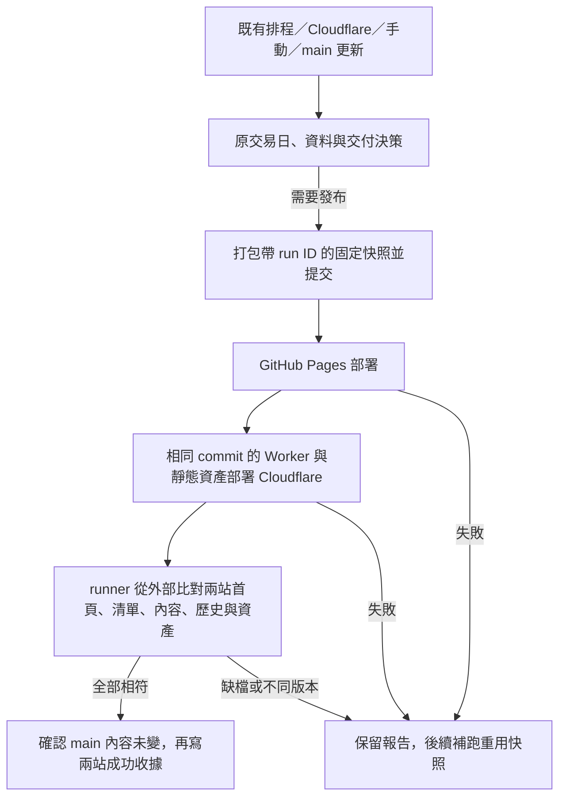

# 最新報告模式與 Cloudflare 網站

[回 README](../README.md) · [Cloudflare 金鑰設定](CLOUDFLARE_SETUP.md) · [交付機制](DELIVERY.md)

[2026-11-25 上線驗收紀錄](audits/2026-11-25-cloudflare-site.md)：實際部署時間、雙站內容驗證、重跑結果及環境限制。

主網站：[pmot-independent-trigger.cjw-9223233.workers.dev](https://pmot-independent-trigger.cjw-9223233.workers.dev/)。GitHub Pages 同步保留；部署是否成功應看當次 Actions 與成功收據，文件連結存在不代表該次發布完成。

## 最新模式與歷史模式

| 操作 | 預期行為 |
| --- | --- |
| 開首頁且沒有 `?report=` | 重新讀 reports.json，按產出時間選最新，實際載入內容後才換日期標示 |
| 停留在最新模式 | 每 60 秒、分頁回到前景或取得焦點時檢查新報告；隱藏分頁不輪詢 |
| 主動選日期／開歷史分享網址 | 進入歷史模式，保留選擇；不被計時更新切到新日期 |
| 按「回到最新」 | 移除網址的 report 參數，重新讀清單並回到最新模式 |
| 休市沒有新報告 | 顯示最新已存在的報告及其真實日期，不把舊數據改標今天 |
| 最新報告有部分缺漏 | 仍顯示最新快照，明示部分資料未確認，不退回舊完整數字冒充最新 |
| 網路／資料讀取失敗 | 保留目前可讀內容，明示未成功切換，不只改新日期卻留舊內文 |
| 獨立歷史 HTML | 保留單份快照，不輪詢，也不啟用歷史選單 |

原本首頁在拿到清單後只更新標籤、相信內嵌內容已最新；舊 index 快取可能因此與日期不一致。現在首次開啟一定載入選定的內容片段，且內容、標題、日期選單與網址在載入成功後才一起更新。較早但較慢的請求不能蓋過使用者最新選擇。

Cloudflare 的 `_headers` 對清單與部署 metadata 使用 no-store，首頁與 JS／CSS 需重新驗證。Python 的固定行情快照仍不可覆寫；輪詢只讀現有檔案，不會查新行情。

## 一份快照，同步部署兩站

Pages 與 Cloudflare 不可能同時原子切換；兩者更新過程可能短暫不同步，因此直到公開驗證通過前都不寫成功收據。部分部署成功也不能略過下次重試。舊的單站收據首次遇到新流程會要求重部署，既有歷史報告不重抓或補造數字。

`build` job 輸出保存快照的 commit；部署兩站均使用此固定版本，避免移動中的 main 導致兩邊檔案不同。`verify-sites.mjs` 以實際檔案 SHA-256 核對公開 HTTP 內容、最新與舊歷史頁、CSS／JS，並驗證 Worker health 與未授權 check。只有同一 run／attempt／report 的兩站 proof 能讓 Python confirm 成功。

## 同一 Worker 的網站與原排程

- `assets.directory=../site`，`ASSETS` binding 提供同版靜態資產；根路徑顯示首頁。
- `/health` 與 `/check` 明確先交給 Worker；`/check` 仍須 CHECK_TOKEN，沒有公開 HTTP 觸發入口。
- 未知路徑維持 404，不以首頁遮蓋 API 錯誤。
- Cron 的日程、GitHub 08:00／08:17／08:37 備援，以及交易日判斷都保留。
- 交付查核直接讀自己的 ASSETS binding，再核對 Pages；不對自己的 workers.dev 發遞迴 fetch。真正公開 Cloudflare 網址由 GitHub runner 外部驗證。

成功收據 `targets.github_pages`、`targets.cloudflare` 必須皆為 verified。部署準備時間不等於完成時間；仍依實際兩站驗證後的確認時間判斷 09:00 前與否。頁面改版後的部署較晚，不代表當日原報告未曾準時交付，首次交付仍要讀歷史紀錄。

## 新手更新與失敗恢復

1. 依 Cloudflare 設定指南準備 `CLOUDFLARE_API_TOKEN` 與 Account ID；不更動 runtime 的 GitHub token／查核密碼。
2. 原每日流程正常交易日會自動發布兩站；程式／資產變更也會重建既有內容發布，不查新行情。
3. 人工改版補發：執行 `Deploy independent Cloudflare trigger`，再追蹤其送出的每日工作；或直接在每日工作勾選 rebuild_only。
4. 任一站失敗，先看部署步驟與 public snapshot mismatch；修正金鑰、權限或網路後，重新跑完整發布，不手動捏造成功收據。
5. 完成後確認根網址可讀、選單包含最新日期、歷史選擇保持、原 health／check 與 Cron 仍正常，再檢查兩站收據。

測試涵蓋舊首頁快取、清單排序、跨日發布、歷史分享、回到最新、離線、請求競態、隱藏／前景分頁、workerd 靜態路由、雙站同版及單站失敗拒絕確認。部署完成後另記錄實際公開網址驗證結果，不以單元測試代替線上部署。
